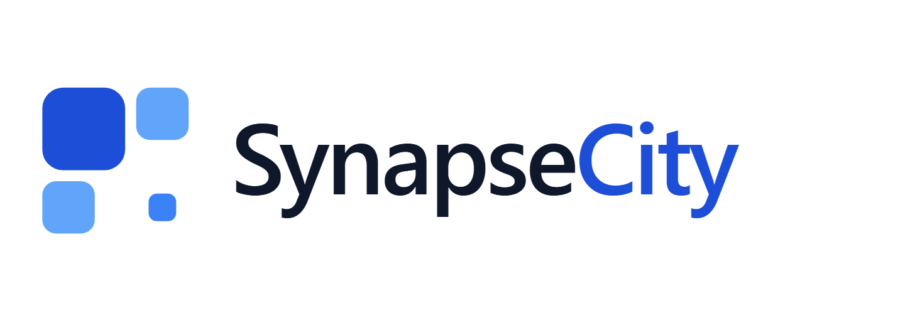
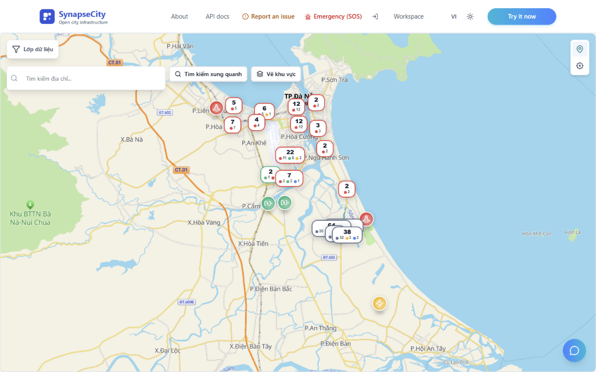
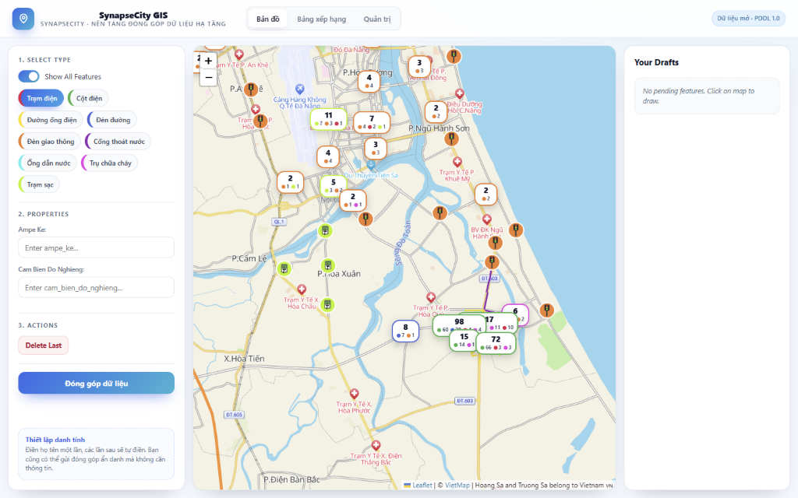
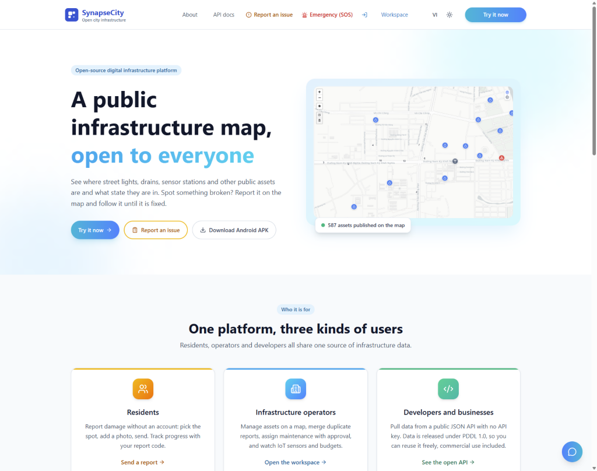

<p align="center">
  <picture>
    <source media="(prefers-color-scheme: dark)" srcset="apps/console/public/brand/logo-lockup-dark.png">
    
  </picture>
</p>

<h3 align="center">Open-source Tier-3 urban infrastructure operations, public GIS map, and citizen reporting</h3>

<p align="center">
  <a href="https://github.com/vku-open-source-2026/SynapseCity/actions/workflows/ci.yml"></a>
  <a href="https://github.com/vku-open-source-2026/SynapseCity/actions/workflows/release.yml"></a>
  <a href="LICENSE"></a>
  <a href="https://opendatacommons.org/licenses/pddl/1-0/"></a>
</p>

<p align="center">
  <a href="https://synapsecity.sbs">Live Portal</a> ·
  <a href="https://synapsecity.sbs/map">Public Asset Map</a> ·
  <a href="https://synapsecity.sbs/docs">Open API Docs</a> ·
  <a href="https://synapsedx.sbs/workspace">Operator Workspace</a> ·
  <a href="https://sos.synapsecity.sbs">Sibling App: SynapseCitySOS</a>
</p>

---

**SynapseCity** is the urban infrastructure domain product (Tier 3) of the Synapse platform. It manages the full lifecycle of physical city assets—GIS registries, QR/NFC lookups, citizen incident reports, IoT sensor telemetry, preventive maintenance, budgets, and open community GIS contributions—built strictly on **SynapseDX** (`@synapsedx/capabilities`) with zero direct database or sibling-product coupling.

## Preview

| Public Infrastructure Map (`synapsecity.sbs/map`) | Community GIS Contribution Portal (`contribution.synapsecity.sbs`) |
| :---: | :---: |
|  |  |

<p align="center">
  
</p>

## Key Features

- **Public GIS Asset Map & Lookup** — Browse street lights, drains, charging stations, and sensors with QR/NFC asset codes and aggregated maintenance summaries.
- **Anonymous Citizen Reporting** — Submit geo-tagged infrastructure issues with photos (`edit_token` + Turnstile protection) and track resolution status without an account.
- **Operator & Technician Workflows** — Manage assets, IoT alerts, work orders, budgets, and operational CSV/JSON reports via portable **SynapseDX** workspace plugins (`plugins/`).
- **Community GIS Contribution Portal** — Dedicated service and UI (`contribution.synapsecity.sbs`) for crowd-sourced infrastructure submissions, moderation, and leaderboards.
- **Native Android App & 4×3 Widget** — GPS asset radar, QR/NFC scanner, citizen reporting, and home-screen status widget (`mobile/`).

## Architecture

```text
Browser / Android App
   │
   ▼
apps/gateway (:8085 host -> :8080 container, Rust/Axum)
   ├──► apps/city-service (:8083, Rust/Axum domain backend)
   ├──► apps/console (React public map, incident reporting & API docs)
   └──► apps/contribution-service + apps/contribution-console (community GIS portal)
   │
   ▼  HTTPS (@synapsedx/capabilities)
SynapseDX (Tier 2) ──► SynapseOne (Tier 1)
```

> **Product Boundary:** SynapseCity owns physical urban infrastructure only. Emergency hazards, EOPs, responder dispatch, SITREPs, and the public hazard map live in its sibling product, [SynapseCitySOS](https://github.com/vku-open-source-2026/SynapseCitySOS). See [PRODUCT_BOUNDARY.md](PRODUCT_BOUNDARY.md).

## Quickstart

### 1. Query the Live Open API (Zero Setup)

Published city infrastructure datasets are available anonymously under **PDDL-1.0**:

```bash
# List published infrastructure assets
curl -s "https://synapsecity.sbs/v1/public/assets?limit=2"

# Inspect a single asset and its maintenance summary
curl -s "https://synapsecity.sbs/v1/public/assets/DN-LIGHT-0001"
curl -s "https://synapsecity.sbs/v1/public/assets/DN-LIGHT-0001/maintenance-summary"
```

### 2. Self-Host with Docker Compose (Recommended)

Requires **Docker Engine 24+** and **Docker Compose v2.24+**:

```bash
git clone https://github.com/vku-open-source-2026/SynapseCity.git
cd SynapseCity
cp .env.example .env                 # configure SYNAPSEDX_BASE_URL, SYNAPSEDX_API_KEY, AUTH_SECRET
export SYNAPSECITY_VERSION=v0.3.0    # or latest

docker compose pull
docker compose up -d --no-build
curl http://127.0.0.1:8085/health
```

### 3. Run Locally from Source

Requires **Node.js 20+**, **Rust 1.82+**, and **Docker Compose v2.24+**:

```bash
npm ci
npm run check:release
npm run build

# Start the Rust city-service against the public Tier-2 demo
SYNAPSEDX_BASE_URL=https://synapsedx.sbs npm run start:service

# In a second terminal, run the web console
npm run dev --workspace=@synapsecity/console
```

## Usage

### Public Open Data Endpoints

| Method & Path | Description |
| :--- | :--- |
| `GET /v1/public/assets` | List published assets (`id`, `asset_code`, `category`, `status`, `location`). |
| `GET /v1/public/assets/:code` | Fetch asset details by record ID or human-readable `asset_code`. |
| `GET /v1/public/assets/:code/qr-code` | Retrieve QR payload for on-site physical asset labels. |
| `GET /v1/public/assets/:code/maintenance-summary` | Read aggregate maintenance counts and latest completed work type. |
| `GET /v1/public/incidents` | List sanitized public infrastructure incident reports. |
| `POST /v1/public/incidents` | File a new citizen report (returns a one-time `edit_token` for photo uploads). |

File a citizen incident report from the command line:

```bash
curl -X POST "https://synapsecity.sbs/v1/public/incidents" \
  -H "Content-Type: application/json" \
  -d '{
    "title": "Street light outage on Le Duan",
    "category": "lighting",
    "severity": "medium",
    "asset_code": "DN-LIGHT-0001",
    "location": { "address": "Le Duan, Hai Chau, Da Nang", "coordinates": [108.2208, 16.0718] }
  }'
```

### Demo Seed & Workspace Plugins

Seed or reset the reproducible 15-minute OLP demo dataset ([docs/DEMO_PACK.md](docs/DEMO_PACK.md)):

```bash
CITY_DEMO_TOKEN=<token> npm run demo:seed
CITY_DEMO_TOKEN=<token> npm run demo:reset
npm run plugins:check   # validate SynapseDX operator workspace plugin bundles
```

### Android Client & Home-Screen Widget

- **Signed APK:** <https://synapsedx.sbs/v1/capabilities/public/files/synapsecity-android-0.1.1-arm64-x86_64/content>
- **GitHub Release:** [`mobile-v0.1.1`](https://github.com/vku-open-source-2026/SynapseCity/releases/tag/mobile-v0.1.1) (`SHA-256: dce9b691ef578d81370b86d7ef767b3eb12aa96e7c149cd7001698a6c0515aa5`)

Build and verify from source ([mobile/README.md](mobile/README.md)):

```bash
cd mobile
npm ci
npm run verify
npm run build:android
```

## Testing & Contributing

```bash
npm test
npm run test:tier-boundary
npm run test:public-only
```

See [CONTRIBUTING.md](CONTRIBUTING.md), [PRODUCT_BOUNDARY.md](PRODUCT_BOUNDARY.md), and [CHANGELOG.md](CHANGELOG.md) before opening a pull request.

## License

Source code is licensed under [Apache-2.0](LICENSE) (see [NOTICE](NOTICE) and [THIRD-PARTY.md](THIRD-PARTY.md)). Published city infrastructure datasets are dedicated to the public domain under **PDDL-1.0**.
