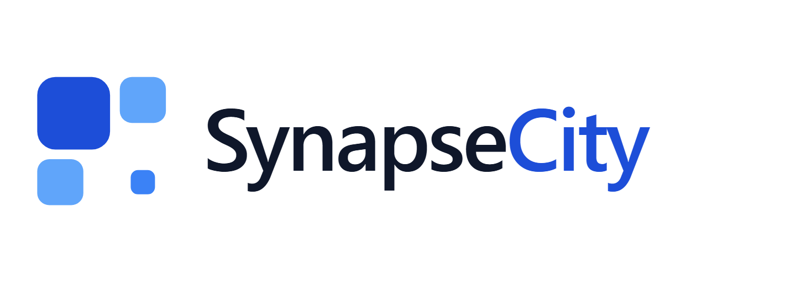

<p align="center">
  <picture>
    <source media="(prefers-color-scheme: dark)" srcset="apps/console/public/brand/logo-lockup-dark.png">
    
  </picture>
</p>

# SynapseCity — city infrastructure operations (Tier 3)

## OLP 2026 demo

A reproducible 15-minute DX-Lab story lives in [`docs/DEMO_PACK.md`](docs/DEMO_PACK.md). Seed/reset with `npm run demo:seed` and `npm run demo:reset` (requires `CITY_DEMO_TOKEN`).


SynapseCity is the city infrastructure product of the Synapse platform. It owns
the day-to-day lifecycle of physical infrastructure: assets and GIS data, city
incidents and citizen reports, IoT sensors, maintenance and technician work,
infrastructure alerts, budgets, operational reports, geofences and data
ingestion, city operators, and the public asset map.

The public product boundary is `https://synapsecity.sbs`. The API is served at
`https://synapsecity.sbs/v1`.

SynapseCity is a **sibling** of SynapseCitySOS (`https://sos.synapsecity.sbs`),
the emergency operations product. SynapseCity does not own hazard feeds,
emergency events, EOP, dispatch, emergency resource units, SITREP, AAR, the
emergency command centre or the public hazard map. A link to SOS is a public
HTTPS navigation link only; there is no City-to-SOS API call.

The authoritative matrix is the workspace `FEATURE_BOUNDARY.md` at the workspace
root. The repo-local summary is [`PRODUCT_BOUNDARY.md`](PRODUCT_BOUNDARY.md).

## Architecture

```text
apps/gateway        public HTTPS API boundary and console proxy (port 8080)
apps/city-service   city infrastructure domain backend (port 8083)
apps/console        city operations console
apps/contribution-service  public data-contribution backend (contribution.synapsecity.sbs)
apps/contribution-console  public data-contribution UI
infra/              public-edge snippets and deployment material
```

Dependency direction:

```text
SynapseCity -> @synapsedx/capabilities -> @synapseone/sdk -> SynapseOne
```

The service is configured with `https://synapsedx.sbs` and calls the Tier-2
capabilities API. It has no database, queue connection or direct SynapseOne
client. Domain records are created through the Tier-2 records API; public
projections are read through Tier-2 SynapseLDS publication. `/v1/geo` calls the
shared Tier-2 geocoder by default; `/v1/map` and `/v1/ai` are City-owned
instances. None of them proxy SOS.

## Features

- infrastructure asset registry, GIS geometry, lifecycle and health;
- city infrastructure incidents and citizen reports;
- IoT sensor metadata, readings and status;
- maintenance work orders, preventive maintenance and the technician portal;
- infrastructure alerts;
- budgets and budget transactions;
- operational reports;
- city operators and user administration;
- public data-contribution portal (submissions, moderation, leaderboard, CSV
  export, map proxy);
- geofences and CSV/data ingestion;
- public asset map, public asset lookup and public incident reporting;
- map tiles, geocoding, reverse geocoding, nearby and polygon search;
- AI capability instance for City.

Not owned by this repository: hazards and VNDMS, emergency events, EOP,
dispatch, emergency resource units, SITREP, AAR, live hazard streaming, the
emergency command centre and the public hazard map. Those are SynapseCitySOS
features.

## Android app and home-screen widget

The `mobile/` directory contains the SynapseCity Android client and a native
4×3 home-screen widget. It talks directly to `https://synapsecity.sbs/v1`:
nearby asset radar/map (GPS), QR/NFC asset lookup, public incident reporting,
optional operator alerts, and a widget with nearest asset, status, mini-map,
scan and refresh actions. The UI is light-first, using the production web
console's teal/white palette. See [`mobile/README.md`](mobile/README.md) and the
verification record in [`docs/MOBILE_AUDIT.md`](docs/MOBILE_AUDIT.md).

```bash
cd mobile
npm ci
npm run typecheck && npm test
npm run verify
npm run build:android
```

Release APK (public, served from Tier-1 SynapseOCS through Tier-2):
<https://synapsedx.sbs/v1/capabilities/public/files/synapsecity-android-0.1.1-arm64-x86_64/content>

GitHub release: <https://github.com/vku-open-source-2026/SynapseCity/releases/tag/mobile-v0.1.1>

SHA-256: `dce9b691ef578d81370b86d7ef767b3eb12aa96e7c149cd7001698a6c0515aa5`

> **Known issue (0.1.1):** the production public asset-detail lookup by asset
> code (`GET /v1/public/assets/:code`) returns 404; lookup by record id works.
> A server-side fix is pending, so the in-app asset detail screen can show
> "not found" for some assets.

CI builds an unsigned APK; the production release job signs it with the
protected keystore and publishes it through the Tier-2 files capability. See
[`mobile/RELEASING.md`](mobile/RELEASING.md).

## Run

The Tier-2 client is published on npm as
`@synapsedx/capabilities@^0.3.0`, so a clean clone builds without a sibling
SynapseDX checkout:

```bash
npm ci
npm run check:release
npm run build
SYNAPSEDX_BASE_URL=https://synapsedx.sbs npm run start:service
```

`npm run check:release` verifies that the dependency is a registry semver
release and rejects `file:`/sibling-checkout dependencies.

Console development:

```bash
npm run dev --workspace=@synapsecity/console
```

The production stack is reproducible with `docker compose up -d --build`; the
Docker build installs the published npm package and needs no sibling repository.

## Self-host

Every release publishes three Apache-2.0 images to the public GitHub Container
Registry (no registry login required):

- `ghcr.io/vku-open-source-2026/synapsecity-city-service`
- `ghcr.io/vku-open-source-2026/synapsecity-gateway`
- `ghcr.io/vku-open-source-2026/synapsecity-console`

> If `docker pull` returns `unauthorized`, the GHCR packages have not been
> switched to public yet. An organization admin must add a `GHCR_PAT` secret
> (package admin) and run the `packages-public` workflow in the SynapseOne
> repository once.

City is Tier 3: point `SYNAPSEDX_BASE_URL` at a Tier-2 SynapseDX deployment and
set a scoped `SYNAPSEDX_API_KEY` issued for this product account. The default
`https://synapsedx.sbs` is the public demo.

### 1. Run the published images (recommended)

```bash
git clone https://github.com/vku-open-source-2026/SynapseCity.git
cd SynapseCity
cp .env.example .env       # set SYNAPSEDX_BASE_URL / API key and AUTH_SECRET
export SYNAPSECITY_VERSION=v0.3.0   # or latest

docker compose pull
docker compose up -d --no-build
curl http://127.0.0.1:8085/health
```

The gateway is bound to loopback; terminate TLS at your own edge and proxy
`/v1` to the gateway (see `infra/nginx/synapsecity.conf`).

### 2. Build from source

Requirements: Node.js 20+, Docker Engine 24+ and Compose v2.24+.

```bash
git clone https://github.com/vku-open-source-2026/SynapseCity.git
cd SynapseCity
cp .env.example .env
npm ci
npm run check:release
npm run build
npm test
docker compose build
docker compose up -d --no-build
```

`docker compose up -d --build` combines the last two steps. Local builds use
the same GHCR image names, so `pull` and `build` are interchangeable.

### Legacy OpenInfra data migration

`npm run import:openinfra` loads the legacy JSON export into the City datasets
through the Tier-2 capabilities API. It never opens a database connection and
never calls SynapseOne directly.

```bash
# Validate the mapping and count the selected rows without writing.
npm run import:openinfra -- --dry-run

# Full master data plus a compact seven-day time-series sample.
npm run import:openinfra

# Re-run safely: existing record ids are skipped.
npm run import:openinfra

# Optional: import every reading/alert instead of the compact sample.
npm run import:openinfra -- --readings=all --alerts=all
```

The default data pack is `../nhan_tmp_data/openinfra_data_2026-11-09`; override
it with `--data-dir`. Assets, sensors, incidents, work orders, budgets, users,
reports and notifications are imported in full. `sensor_readings` and `alerts`
are compacted (one reading per sensor per two hours inside the densest history
window, plus the latest reading per sensor; meaningful alerts plus the latest
offline alert per sensor). Use `--readings-interval-hours` and
`--readings-window-hours` to change that sample. The run stores a resumable
checkpoint in `.notes/import-openinfra.state.json`. Emergency, hazard, EOP,
dispatch, SITREP, AAR and resource-unit collections are owned by
SynapseCitySOS and are deliberately skipped.

## API

### Public open API (documented at `/docs`)

Only the read-only public projection is public:

```text
GET  /v1/public/assets
GET  /v1/public/assets/:code
GET  /v1/public/assets/:code/qr-code
GET  /v1/public/assets/:code/maintenance-summary
GET  /v1/public/incidents
GET  /v1/public/incidents/:incidentId
POST /v1/public/incidents
POST /v1/public/incidents/:incidentId/photos
POST /v1/public/files
GET  /v1/public/files/:id/content
```

These routes are anonymous and expose only published/`public_visible` records.
The response is a stable City JSON object, **not** NGSI-LD: assets return
`{ id, asset_code, name, feature_type, feature_code, category, status,
location: { address, coordinates, geometry }, qr_code, public_url }`, and
incidents return the public projection with reporter contact details, internal
comments and assignee identity removed. Soft-deleted, decommissioned and
`public_visible:false` assets are excluded from every public route, including
the QR-code and maintenance-summary lookups. `maintenance-summary` exposes
aggregate counts and the last completed maintenance type only; public pages
never call the private maintenance namespace.

The public documentation intentionally omits every operator, auth/session, CRUD
and administrative endpoint.

### Internal console API (not public, not documented at `/docs`)

The gateway also owns the console/operator namespaces below. They are internal
product APIs, not part of the open-data contract:

```text
GET  /health, /ready
GET  /v1/city
*    /v1/assets          *    /v1/incidents
*    /v1/maintenance     *    /v1/preventive-maintenance
*    /v1/iot             *    /v1/alerts
*    /v1/budgets         *    /v1/reports
*    /v1/notifications   *    /v1/users
*    /v1/geofences       *    /v1/geo
*    /v1/ingest          *    /v1/map
*    /v1/ai              *    /v1/auth
POST /v1/public/incidents   (citizen report UI only)
```

`GET /v1/city` advertises the owned feature list and the not-owned SOS feature
list. Foreign namespaces `/v1/emergency*`, `/v1/hazards*` and `/v1/sos*`
return `404` with `{ "error": "not_found" }` before any handler or Tier-2 call.
The API intentionally does not expose generic platform primitives; those stay
behind SynapseDX and SynapseOne.

### Authorization

Every operator namespace requires a signed City session. The gateway rejects an
operator request without an `Authorization` header before proxying, and the
service independently verifies the HMAC session and the role-derived
permission. Deny-by-default: an unknown operator action requires a valid session
and then returns `404`.

| Permission | admin | manager | technician | volunteer | citizen |
| --- | --- | --- | --- | --- | --- |
| `assets:read` / `assets:write` | ✓ / ✓ | ✓ / ✓ | ✓ / – | ✓ / – | – / – |
| `incidents:read` / `incidents:write` / `incidents:verify` | ✓ / ✓ / ✓ | ✓ / ✓ / ✓ | ✓ / – / – | ✓ / – / – | – / – / – |
| `maintenance:read` / `maintenance:write` | ✓ / ✓ | ✓ / ✓ | ✓ / ✓ | – / – | – / – |
| `iot:read` / `iot:write` | ✓ / ✓ | ✓ / ✓ | ✓ / – | – / – | – / – |
| `alerts:read` / `alerts:write` | ✓ / ✓ | ✓ / ✓ | ✓ / – | – / – | – / – |
| `budgets:read` / `budgets:write` / `budgets:approve` | ✓ / ✓ / ✓ | ✓ / ✓ / ✓ | – / – / – | – / – / – | – / – / – |
| `reports:read` / `reports:write` / `reports:generate` | ✓ / ✓ / ✓ | ✓ / ✓ / ✓ | – / – / – | – / – / – | – / – / – |
| `notifications:read` / `notifications:write` | ✓ / ✓ | ✓ / ✓ | ✓ / – | ✓ / – | – / – |
| `files:read` / `files:write` | ✓ / ✓ | ✓ / ✓ | ✓ / ✓ | ✓ / – | – / – |
| `users:read` / `users:admin` | ✓ / ✓ | ✓ / – | – / – | – / – | – / – |
| `geofences:read` / `geofences:write` | ✓ / ✓ | ✓ / ✓ | – / – | ✓ / – | – / – |
| `ingest:write` | ✓ | ✓ | – | – | – |
| `geo:read` / `ai:use` | ✓ / ✓ | ✓ / ✓ | ✓ / – | ✓ / – | – / – |

`/v1/users/me`, `/v1/auth/me` and `/v1/auth/verify` require a session but no
additional permission. A technician only sees work orders assigned to their own
principal. Anonymous surfaces are `/health`, `/ready`, `/metrics` (optional
token), `/v1/city`, `/v1/auth/*`, `/v1/public/*` and `/v1/map/*`.

`/v1/users` requires a Bearer session and never accepts, stores or returns
password fields. In the default **`tier2` identity mode**, `/v1/auth/login` and
`/v1/auth/register` verify credentials through the Tier-2 auth capability
(Tier-1 IAM); the Tier-1 token stays inside the signed City session and is never
returned to the browser. City roles are resolved from City-owned operator
profiles (`city-users`) or the server-side `CITY_BOOTSTRAP_ADMIN_EMAILS`
allow-list — never from a request body, request claim or unverified token.

`CITY_AUTH_MODE=demo` selects the explicit development-only session shell. It is
honoured only when `AUTH_DEMO_MODE=true` (default outside production); the demo
role comes from `AUTH_DEMO_ROLE`. A demo session cannot change passwords and is
refused in production unless deliberately enabled. Tokens are kept in tab-scoped
`sessionStorage`, logout revokes the presented access/refresh tokens and the
Tier-2 session, and `CITY_AUTH_EXCHANGE=true` additionally mints a delegated
`synapsecity`-audience token when the deployment's service credential is allowed
to exchange.

Autocomplete, forward geocoding and reverse geocoding use the shared,
provider-neutral Tier-2 `geo` capability by default (`CITY_GEO_PROVIDER=tier2`);
City holds no provider key on that path. `CITY_GEO_PROVIDER=vietmap` is an
explicit legacy opt-in for map **tiles** (`VIETMAP_API_KEY`,
`VIETMAP_TILE_STYLE=tm|lm|dm|hm|st`); the key is never sent to the browser. A
Tier-2 provider outage is surfaced as `503 geocoder_unavailable`, not hidden by
a silent fallback (`CITY_GEO_FALLBACK_VIETMAP=true` opts into one).

### Reports, files, AI and notifications

- Operational reports are generated synchronously into real **CSV** or **JSON**
  bytes from City assets, incidents and maintenance. The bytes are stored on the
  report record and `GET /v1/reports/:id/download` streams them with the correct
  content type and `Content-Disposition`. `pdf`/`excel` return
  `415 unsupported_report_format`. The synchronous decision and the conditions
  for adopting the Tier-2 runner are documented in [`docs/REPORTS.md`](docs/REPORTS.md).
- Photos and documents are uploaded through the Tier-2 **files** capability
  (Tier-1 object storage):
  - `POST /v1/files/upload` (raw bytes) and `PUT /v1/files/:id/content` (proxy
    upload) store the bytes in Tier-1 and keep only metadata in `city-files`;
  - `POST /v1/files` starts a create/presign flow, `POST /v1/files/:id/presign`
    returns a signed URL when the backend supports it (otherwise
    `501 presign_unsupported`), and `POST /v1/files/:id/complete` finalizes it;
  - `GET /v1/files/:id/content` streams the object and
    `GET /v1/public/files/:id/content` serves public report photos;
  - MIME allow-lists, size limits (`CITY_FILES_MAX_BYTES`,
    `CITY_PHOTO_MAX_BYTES`), SHA-256 checksums and owner/tenant checks are
    enforced before any Tier-2 write. `data:` URLs and inline base64 are
    rejected (`415`).
- `/v1/ai/status` and `/v1/ai/chat` proxy the Tier-2 AI capability
  (`ai.status`/`ai.chat`). Missing provider or contract returns a typed 503 and
  the widget shows the error; no canned answer is ever returned.
- Notifications are produced on real City transitions (citizen report, incident
  assignment/resolution, critical/high alert, work-order assignment/completion,
  report ready) and delivered **in-app** through the `city-notifications`
  projection. When `CITY_NOTIFY_EXTERNAL=true`, the same event is sent through
  the Tier-2 `notifications` capability using City templates, the recipient's
  City profile addresses, an idempotency key and Tier-2 preferences; each
  channel's receipt is stored on the projection. With no configured channel the
  status is `not_configured`, never `delivered`.

### Abuse controls and observability

`/v1/auth/*` and anonymous reporting are rate limited (`429` with
`Retry-After`). When `TURNSTILE_SECRET_KEY` is configured, the Turnstile token
sent in `CF-Turnstile-Response` is verified server-side; `REQUIRE_TURNSTILE=true`
fails closed when the secret is missing. `/health` and `/ready` report
per-capability state (datasets/records, files, AI, notifications, identity,
geo and jobs),
`/metrics` exposes Prometheus-style counters (optionally protected by
`METRICS_TOKEN`), and requests emit structured JSON logs with the correlation
id.

### GIS analytics

`POST /v1/geo/coverage` computes coverage gaps by area and asset type with
population and open-incident weighting (see `apps/city-service/src/analytics.ts`
for the exact formula), and the console exposes it at `/admin/analytics`.

## Console

The City console serves these owned routes:

```text
/                              city landing
/about /docs                   product and API docs
/map                           public city asset map
/login /register               auth shell
/asset/$id                     public asset detail
/public/report                 citizen incident report
/public/report/$assetId        report about an asset
/public/incidents/$incidentId  public incident lookup
/admin                         city operations dashboard
/admin/map /admin/assets       internal map and asset registry
/admin/assets/create           asset registration form
/admin/assets/edit/$id         asset edit form
/admin/incidents /admin/alerts city incidents and infrastructure alerts
/admin/iot /admin/budgets      sensors and budgets
/admin/reports /admin/users    reports and city operators
/admin/analytics               GIS coverage analysis
/admin/ingest /admin/settings  ingestion and profile
/technician[/tasks|/maintenance|/settings] technician portal
```

There is no `/disaster` route and no `/admin/emergency-center` route. Never add
hazard, EOP, dispatch, SITREP, AAR or command-centre pages to this console.

## Public edge

The public edge routes `synapsecity.sbs` to the gateway. The gateway proxies
`/v1` to `city-service` and serves the console for browser routes. See
`infra/nginx/synapsecity.conf`.

## DX-OS 2026

City is a Tier-3 domain application in the OLP 2026 DX-OS model: it owns city
assets, incidents, maintenance and budget rules, and consumes reusable H-P-D-I
capabilities from SynapseDX over the public API. It never imports the Tier-1
SDK or calls a Tier-1 service directly. The tier matrix, HITL contract and OLP
evidence checklist are in
[`SynapseDX/docs/DX_OS_TIER_MODEL_2026-11-04.md`](https://github.com/vku-open-source-2026/SynapseDX/blob/main/docs/DX_OS_TIER_MODEL_2026-11-04.md).

## PoF project checklist

- Source license: Apache-2.0 (`LICENSE`) with per-source SPDX headers and attribution in `NOTICE`.
- Data license: **PDDL 1.0** (Open Data Commons Public Domain Dedication and License) for published City datasets.
- Build from source: `npm ci && npm run build` using Node.js 20+; Docker builds are reproducible with `docker compose build`.
- Issue tracker: [GitHub Issues](https://github.com/vku-open-source-2026/SynapseCity/issues).
- Change history: [`CHANGELOG.md`](CHANGELOG.md). Versioned release tags are published on GitHub.
- Dependency inventory: [`THIRD-PARTY.md`](THIRD-PARTY.md); dependencies are not modified or bundled into the repository.

## Brand

Logo, icon and social-preview assets live in [`apps/console/public/brand`](apps/console/public/brand). The console serves the favicon, web app manifest and icons from `apps/console/public`.

To set the GitHub repository social preview, upload [`apps/console/public/brand/social-preview.png`](apps/console/public/brand/social-preview.png) in **Settings → Social preview**.
